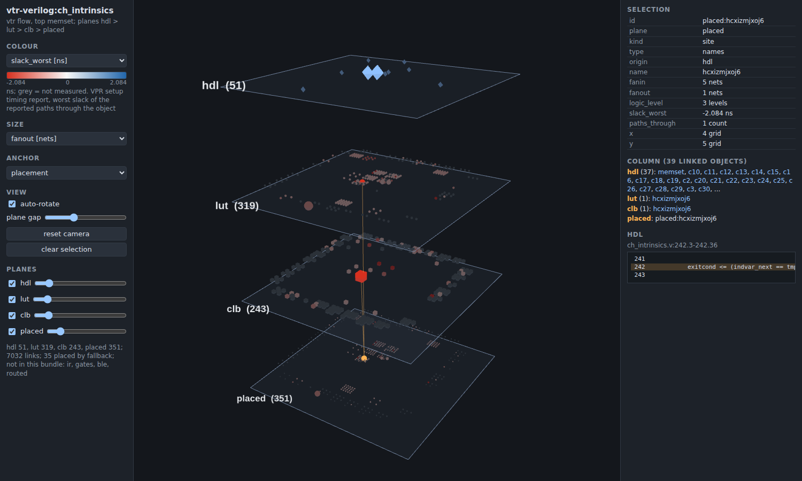

# Heimdall III

The watchman who sees all nine worlds and guards the Bifrost. Heimdall III is the 3D provenance viewer of
Yggdrasil III: one benchmark as a stack of planes, from the HDL down to the placed chip, with every object linked
to the HDL line it came from. It was `o3viz` inside Wyrd III and is now its own project, with its history kept.

Purpose: teaching and research view of what HDL becomes at every stage of a flow (provenance at every
granularity; graph analysis of netlist structure). Two targets by design: the FPGA flow (LUT, cluster, placed
atoms on the VPR grid) today, and the ASIC flow (Odin III, OpenROAD, GDS, `sky130_fd_sc_hd`) later; the ASIC
exporter is a stub (`heimdall/targets/asic.py`). Spec: `docs/specs/2026-11-05-heimdall-design.md`.

## Use

    heimdall export RUN_DIR --out design.o3viz --benchmark suite:design --src HDL_DIR
    heimdall serve design.o3viz                 # http://127.0.0.1:8765/ ; Ctrl-C to stop
    heimdall site --out SITE --base-url https://drpeterjamieson.com/RESEARCH/HEIMDALL/ SPEC...

Details, controls and screenshots: `docs/user/viz.md`; the viewer has its own help page (press `?`).
Python 3.11+, standard library only at runtime. Odin III, VPR and ABC are used only as programs.

## The site

The built site is a plain directory of static files (no server code). Peter uploads it to
`https://drpeterjamieson.com/RESEARCH/HEIMDALL/` (`heimdall_base_url`); the Mimir III catalogue links each
design that has a page there. Nothing is uploaded by the tools.

First site (flows with Odin III main e5efb64e, binary `rel-main3`): the Odin III micros that reach the VTR flow,
twelve VerilogEval designs, `ch_intrinsics` and `sha`. The list is filled in below when the flows are run.

## Citations

- P. D. Kundarewich, "Synthetic Circuit Generation Using Clustering and Iteration", MASc thesis, University of
  Toronto, 2002 (Comb and Latched matrices, sections 2.1, 3.1 to 3.3, 5.1).
- M. Hutton, J. Rose, J. Grossman and D. Corneil, "Characterization and parameterized generation of synthetic
  combinational circuits", IEEE TCAD 17(10):985-996, 1998, and M. Hutton, J. Rose and D. Corneil, "Generation of
  synthetic sequential benchmark circuits", FPGA 1997; used as the thesis describes them.
- J. Rose et al., "The VTR project", 2012, and VTR 9 (TRETS 2025), for the flow the FPGA planes come from.

## Licence

MIT, as Wyrd III. three.js is vendored under `heimdall/web/vendor` (MIT, licence file kept).
