# Heimdall III: the 3D provenance viewer

(Formerly `o3viz` in Wyrd III; the image file names keep that prefix.)

Heimdall III shows one benchmark as a stack of planes in a web browser: the HDL constructs on top, then the LUTs
Odin III made, the VPR clusters, and the placed atoms on the real FPGA grid at the bottom. Each plane can be
coloured and sized by any measured parameter, and a click on an object highlights its column through all the
planes and shows the HDL lines behind it. Design: `docs/specs/2026-11-03-o3viz-design.md` (viewer) and `docs/specs/2026-11-05-heimdall-design.md` (project, two targets, site).

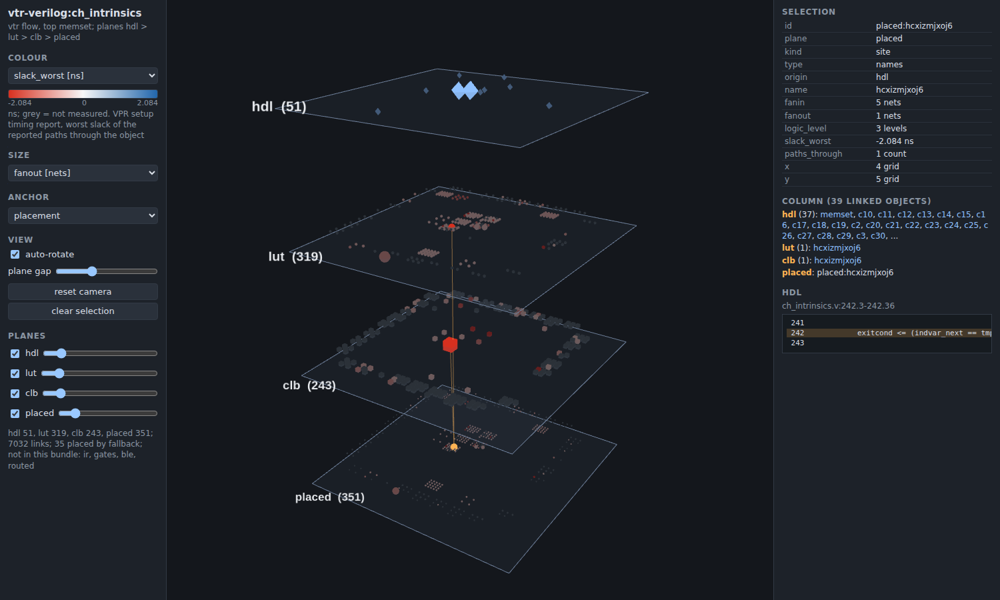

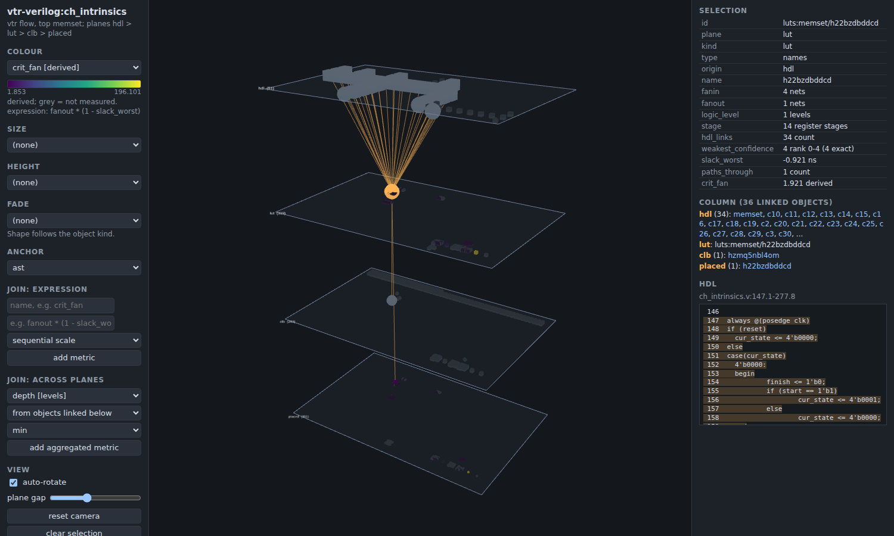

## Versions

The version is `heimdall.__version__` (one place; the help page, the guide and the site index read it).

| version | what | date |
|---|---|---|
| v0.1 to v0.3 | viewer milestones M3 to M7 and the static site (earlier "updates 1 to 3" had no separate heading) | 2026-11-05 |
| v0.4 (update 4) | rainbow lines, bit squares, reverse groups | 2026-11-06 |
| v0.5 (update 5) | ASIC planes (silicon flow) | 2026-11-06 |
| v0.6 (update 6) | graph analytics: signatures, clusterings, graphlet types | 2026-11-06 |
| v0.6.1 | affinity propagation fix | 2026-11-06 |
| v0.7 | switching-activity overlay (Bifrost III power) and compare on any selection | 2026-11-07 |
| v0.8 | graphlet instance view (Odin III `graphlets --instances`); metric port checked to 1e-9 | 2026-11-07 |

## Make a bundle

Run the benchmark through the Odin III flow with provenance and keep VPR's files, then add the placement
records and the step files (the Odin III tools are `odin3-flow`, `odin3-prov-post`, `odin3-prov-steps`):

    odin3-flow design.v --prov --keep-results --out RUN
    odin3-prov-post RUN
    odin3-prov-steps RUN
    heimdall export RUN --out design.o3viz --benchmark vtr-verilog:design --src DIR_WITH_design.v [--odin3 PATH]

The bundle is a directory of JSON files (`manifest.json`, `planes/`, `links.json`, `edges/`, `anchors/`, `hdl/`),
deterministic: exporting twice gives the same bytes. A value that was not measured is `null` and shows grey.

## View it

    heimdall serve design.o3viz            # prints http://127.0.0.1:8765/ (use --port N for another) ; open it in a browser

Everything is served locally; three.js is vendored (`heimdall/web/vendor`, MIT), nothing is fetched from a
network.

- Help: the "? Help" link at the top of the left panel, or the key `?`, opens `heimdall/web/help.html` (what the planes are, every control,
  the shortcut table, known limits) in a new tab. It is one static file with its own `images/`, so it moves with `web/`.
- Source pane (left, 40% of the width; drag the divider to resize): the whole HDL file with line numbers, tabs
  for several files. Click a line, or drag or shift-click a range. The constructs whose span covers the lines
  (the innermost ones; tick "include enclosing constructs" for all) are selected, then every linked object on
  the planes below (LUTs, clusters, placed atoms) through the links. They are highlighted in 3D, the rest is
  dimmed, and the right panel shows one count per plane. Clicking an object in 3D does the reverse: its HDL lines
  are highlighted in the pane and scrolled to.
- Drag to rotate, right-drag to pan, "auto-rotate" and "plane gap" are in the left panel.
- Plane control: keys 1 to N focus a plane (the orbit target moves to the plane centre), 0 is the whole stack;
  the "focus" buttons in the Planes list and in the right panel do the same. The wheel zooms towards the point
  under the cursor on the focused plane (or the nearest plane when none is focused). Each plane has show,
  opacity and "solo".
- Colour: any metric. Slack uses a diverging scale (red is negative). Grey means not measured. "colour = logic
  depth" sets the colour to `logic_level` on all planes; the legend lists, per plane, how many objects have a
  measured value and the range, and says "no measured value" when a plane has none.
- Size: any metric.
- Click an object: the right panel shows its fields and metrics and one line per plane (count of linked objects
  and a focus button). Click empty space to clear.

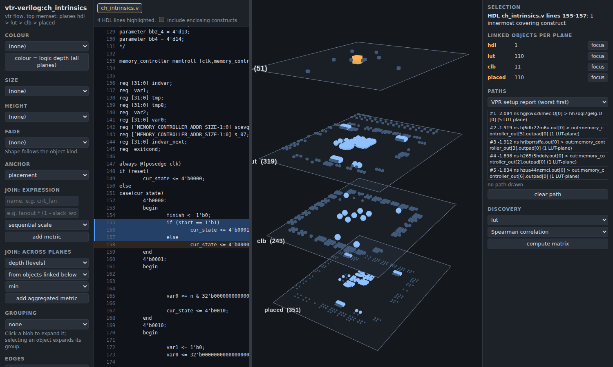

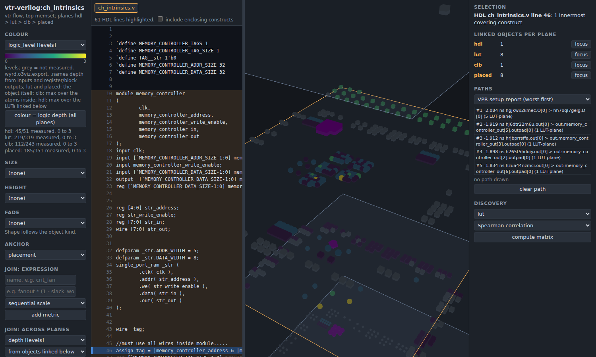

### Paths

The Paths section draws combinational paths as polylines through the objects they pass on the lut and placed
planes, and highlights the HDL lines they come from. The source is always labelled.

- VPR setup report: the reported setup paths (`report_timing.setup.rpt`, kept in `paths.json`) sorted by slack,
  worst first. Click one to draw it. Only the data-arrival part is used; clock-network pins are left out.
- Netlist cone: from the selected objects (an object, a line, a path), the fan-in, fan-out or both cones in the
  LUT netlist (`edges/lut.json`), with a depth limit. The cone stops at flip-flops, I/O and hard blocks, which
  are shown as its boundary. It follows the selection while this source is chosen.

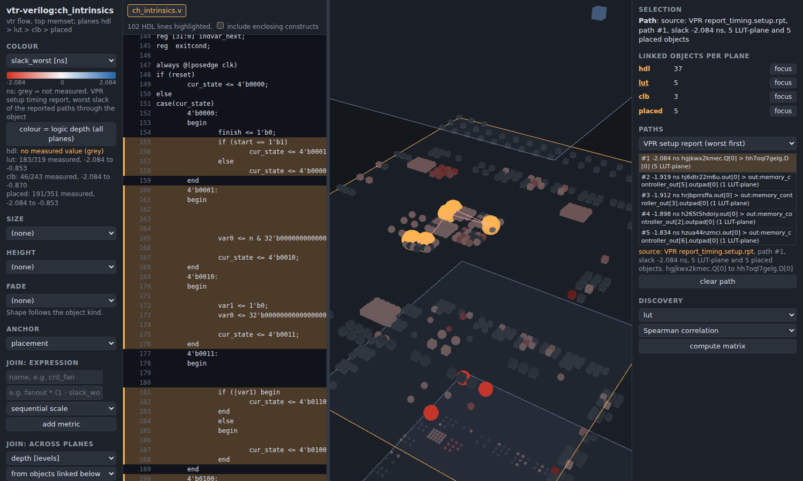

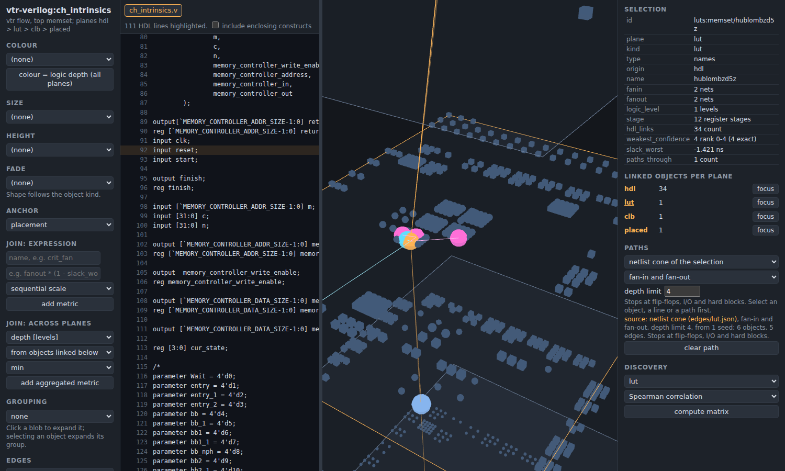

## What a plane is

| Plane | Objects | Position under the `placement` anchor |
|---|---|---|
| `hdl` | HDL constructs (module, block, statement) from the step file `read` | centroid of the LUTs whose chain reaches it |
| `lut` | nets and LUTs of the mapped netlist (step file `map`) | the placed atom with the same name |
| `clb` | VPR top-level blocks (logic clusters, IO pads, memories) from the `.net` | centroid of the atoms inside |
| `placed` | one per atom (step file `place`) | the real VPR grid tile of its cluster, spread inside the tile |

Planes that Odin III's step files do not write yet (`ir`, `gates`, `ble`, `routed` in v1.4) are not shown; the
manifest lists them as missing. Objects with no placed atom (nets that mapping removed) are put at the mean of
their placed neighbours or the grid centre and counted as `unanchored` in the manifest.

## Anchors (layouts)

The anchor decides where each object sits on its plane; the dropdown switches it without reloading.

- `placement`: the real grid at the bottom; upper planes at the centroid of what they link to.
- `ast`: the HDL construct tree (tidy tree, root on top, one leaf per column); a LUT sits at its deepest
  construct, a cluster at the mean of its LUTs, a placed atom with its LUT.
- `pipeline`: x = register stage (a flip-flop or a block output adds one to the deepest input stage), one square
  block per stage, atoms ordered by logic level inside it; upper planes at the centroid.
- `level`: x = logic level (LUT depth from inputs and register or block outputs), one square block per level,
  atoms ordered by worst slack inside it (worst first, not measured last). It is not yet slack-weighted.

Objects that have no position of their own (a net that mapping removed, an IO pad with no placed atom in an anchor
that needs one) are moved to a strip below the plane and counted in the manifest; a guess is never drawn as a
measurement.

## Channels and joins

Colour, size, height above the plane and fade (blend to the background) take any metric; the shape follows the
object kind. Two joins build new metrics, which then appear in every dropdown:

- Expression: a name and a formula over metric names, for example `fanout * (1 - slack_worst)`. Operators
  `+ - * / % ^`, comparisons, and `abs sqrt log log2 exp floor ceil round min max pow clamp if`. It is parsed by
  a small parser of its own (`heimdall/web/expr.js`, no `eval`). A missing value gives a missing result.
- Across planes: `min`, `max`, `mean`, `sum` or `count` of a metric over the objects linked below (for an HDL
  construct, its LUTs) or above (for a LUT, its constructs). Direct links only, one hop.

## Exploring a bigger design (M3)

- Discovery panel (right): pick a plane and Spearman correlation or mutual information (8 equal-width bins, bits);
  it shows the matrix of the metrics with 10 or more values. Click a cell: colour = row metric, size = column
  metric. Pairs with a missing value on either side are left out.
- 2D view: "View" shows one plane from above (rotation off). Morph: choose two adjacent planes and drag the slider;
  the lower plane rises to the upper one and its objects slide to the centroid of the upper objects they link to.
- Brush: hold Shift and drag a rectangle; the objects of the chosen plane inside it are selected and their linked
  objects on the other planes are highlighted (counts in the right panel).
- Edges: "k-hop of selection" draws the netlist edges within k hops of the selected LUT-plane objects (loaded on
  demand); "between groups" draws one line per pair of groups, brighter for more edges.
- Grouping: by HDL module or by VPR cluster, one blob per group on the lut and placed planes (colour = mean of the
  colour metric); click a blob to expand it; selecting an object expands its group.

Large benchmark used: VTR `sha` (1289 LUTs, 142 CLBs by `odin3-flow`; planes hdl 201, lut 2893, clb 216,
placed 2568; 344806 links). Bundle sizes: ch_intrinsics 448 kB (65 kB gzipped), sha 7.3 MB (1.4 MB gzipped), the
links table being 4.7 MB of that. At this size JSON loads without trouble, so Arrow is not needed yet; the reader
is the one function `loadBundle` if a design of 100x this size needs it.

## M5: case items, the cell plane, buses, flip-flops

Peter's questions on the M4 viewer: where are the muxes of a case, how does one line of a case sit in the rest of
it, how to tell a bus apart, and where are the flip-flops.

**Cell plane (between hdl and lut).** `heimdall export` re-runs the flow's Odin III script (read from
`odin3/odin3.log`) with two extra `write_json` dumps: the netlist right after `proc` (word cells: `$mux`, `$pmux`,
`$eq`, `$dff`, with their HDL spans and provenance records) and the netlist right before the BLIF write (the wire
names of the nets that survive). Odin III is used as a program only; no Odin III change was needed. Links: a cell
links to the HDL constructs with its exact spans and their ancestors; a cell to the LUTs whose provenance record
chain derives from the cell's record (`cone`, `high`); an `$eq` against a constant that is the label of exactly one
item of a case links to that item only (`structural_match`, `medium`; the select cell of the item). A flip-flop
cell links to the latches of the same bus (`name`, `medium`). If the dump run fails the bundle has no cell plane and
says why in `manifest.notes`.

**Case tiers.** Click a line inside a case or an if/else chain (a construct with two or more `branch` children).
The clicked item is tier A (orange, own), the case itself and logic serving the item together with others is tier B
(teal, shared: select and mux), the other items are tier C (violet, context); everything else fades. The source pane
shows the clicked item with an orange bar, the case header teal and the other items in a light tint. The right panel
counts A, B and C per plane. A plane without HDL links (clb, placed) takes the best tier of the objects linked above.

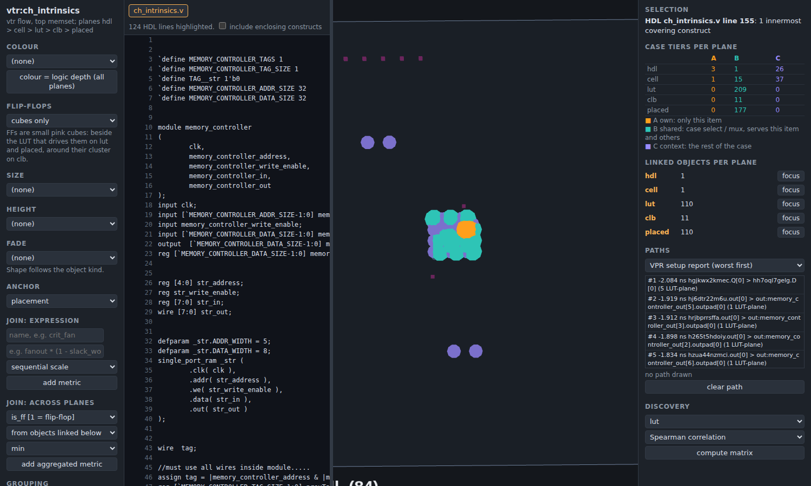

On `ch_intrinsics` the result is honest, not flattering: Odin III extracts the 15-state FSM, so after mapping every
LUT carries the spans of all 15 items and the lut, clb and placed planes show only tier B for any item. Items are
told apart on the cell plane (before FSM and ABC merge them): the select `$eq` of an item and the `$mux` of an inner
`if` are tier A, the `$pmux` is tier B.

**Buses.** Colour = "bus (hue per bus, shade per bit)". The legend lists the buses with a filter box and the count
of objects per bus; a click selects the bus on every plane and marks its declaration line. A bus name comes from the
object's own net (a port, a register, a flip-flop cell named after its register) or, for logic with no name, from
the one bus it feeds (`busk` = `cone`; nothing is shown when it feeds more than one). Everything else stays grey and
is counted ("no bus"). The post-ABC nets are matched to the BLIF by net number with an offset that is verified on
every LUT cell; if it does not hold the lut and placed planes get no bus names and the manifest says so. On
`ch_intrinsics` `var0` exists on the cell plane only (its logic is removed before mapping); `cur_state` is 4 bits in
the source and 15 after one-hot recoding, and the bus keeps the 15.

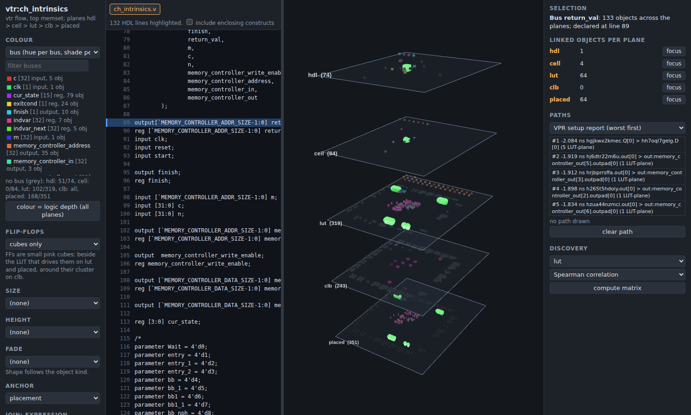

**Declared signals.** Every declared reg, wire and port is an object on the hdl plane (kind `signal`), at its
declaration line. Clicking the line selects the flip-flops (reg) or driving logic (wire) on every plane it reaches.

**Flip-flops.** FFs are small pink cubes on every plane: beside the LUT that drives their D input on lut and placed
(joined by a short edge), around their cluster on clb (a cluster shows `ffs_inside` cubes). Select "FFs only" to dim
everything else. Metric `is_ff` marks them in the data.

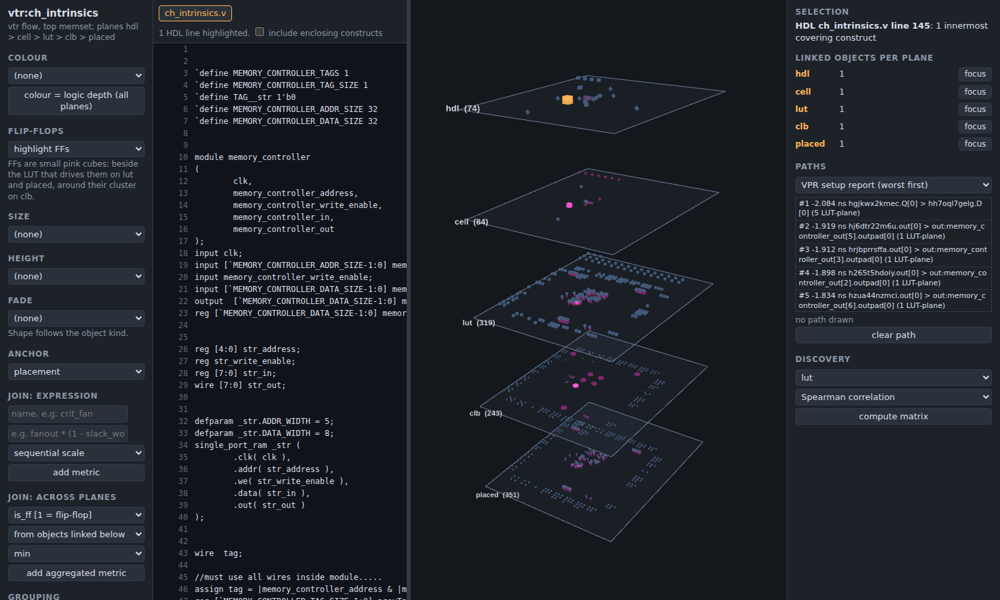

## M6: Hutton and Kundarewich circuit views, graded tiers, SCOAP, collapsible panels

Sources (thesis text read for the definitions, PDFs not committed): P. D. Kundarewich, "Synthetic Circuit Generation
Using Clustering and Iteration", MASc thesis, University of Toronto, 2002 (sections 2.1, 3.1 to 3.3, 5.1), which
describes M. Hutton, J. Rose, J. Grossman and D. Corneil, "Characterization and parameterized generation of synthetic
combinational circuits", IEEE TCAD 17(10):985-996, 1998, and M. Hutton, J. Rose and D. Corneil, "Generation of
synthetic sequential benchmark circuits", FPGA 1997. The two Hutton papers are not on disk; they are used as the
thesis describes them. Descriptive only: no hypothesis is tested.

**Definitions as implemented** (`heimdall/hutton.py`, `circuit.py`, `web/circuit.js`; same numbers in Python and
JavaScript tests on one hand-computed sequential circuit, `tests/data/o3viz/hutton/s.blif`):

- Objects are the lut-plane objects: LUTs, flip-flops, hard blocks and the primary inputs that something reads.
- Delay level (metric `logic_level`): 0 for primary inputs, flip-flops and block outputs, a LUT is one more than its
  deepest input (Hutton's unit delay; Kundarewich 3.1 puts flip-flops at level 0). `dmax` is the largest.
- Shapes per delay level: node shape (objects), input shape (LUT input pins), output shape (objects that drive
  something), PO shape (objects that drive a primary output). Fanout distribution: objects per number of LUTs driven
  (`fanout_comb`). Edge length of an edge into a LUT: level(sink) - level(source); an edge into a flip-flop (the DFF
  edge from a latched node) has length 0 by definition, an edge into a hard block is counted apart.
- Latched node (`is_latched`): a LUT that drives a flip-flop's D input.
- Sequential level (`seq_level`, Hutton 2.1.3): 0 at a primary input, one more through a flip-flop, MIN over the inputs
  otherwise. On a circuit with feedback the recursion has no unique solution; the viewer uses its least solution, the
  fewest flip-flops on any path from a primary input. A net no primary input reaches has no value (grey).
- Comb[i][j] counts the edges from cluster i that drive combinational nodes in cluster j, Latched[i][j] those that
  drive flip-flops in cluster j (3.3.2). The diagonal is drawn dim (edges inside a cluster).

**Anchors.** `hutton`: x = delay level, objects stacked per level (wrapping into sub-columns), flip-flops at level 0
with the primary inputs and joined to their latched node by the DFF edge (no longer drawn beside the driver; the
flag `ff_attached` in the anchor file). `hutton_seq`: the same, one strip per sequential level. `kundarewich-<source>`:
one strip per cluster of the source. Level ticks and strip names are drawn on the lut plane.

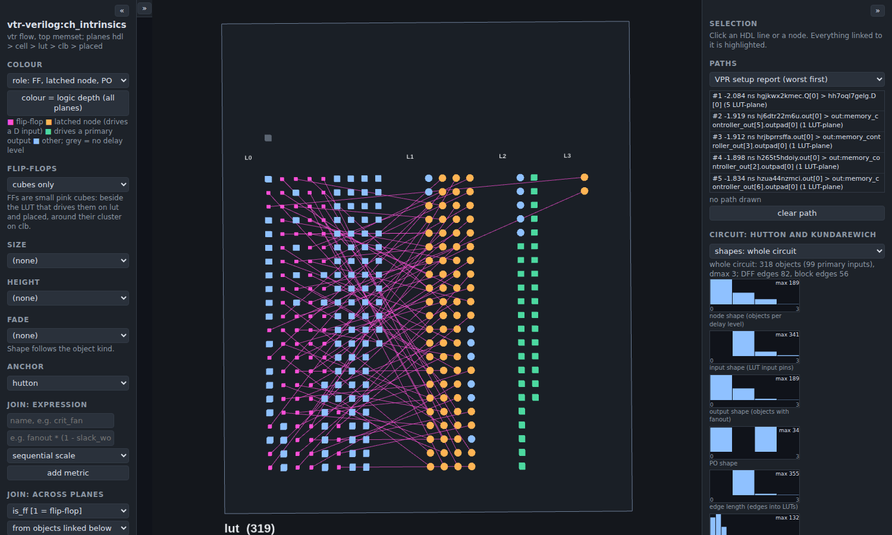

**Cluster sources** (`clusters.json`, dropdown in the right panel; choosing one under a Kundarewich anchor switches
the anchor): `hdl-module`, `hdl-block` (a direct child of a module: an always block, an assign, an instance),
`hdl-item` (a case item or if/else branch; objects with none fall back to their block) from provenance; an object that
reaches several clusters takes the one with the smallest span and is counted ("reach several clusters"); a
flip-flop with no HDL link takes its driver's cluster; `vpr` (the packer's clusters); `mincut` (recursive
Fiduccia-Mattheyses hypergraph bipartition in `partition.py`, standard library, seeded, deterministic; k defaults to
the number of HDL block clusters within 2 to 16, `heimdall export --clusters K` to choose). Kundarewich used hMETIS;
this is not hMETIS and its cut is a heuristic result. Objects with no cluster form "(none)".

**Panel.** Shapes of the whole circuit or of the current selection (an HDL line's logic gets its own shape; edges
count only when both ends are in the selection). For the source: cluster x level counts, Comb and Latched heat maps
(log scale), the share of edges between clusters (the thesis's inter-cluster percentage). Click a heat-map cell: the
edges of that cell are drawn in yellow, their endpoints and the HDL lines behind them are selected. "compare with"
shows two sources side by side with the normalised mutual information of the two partitions, which says how close the
HDL hierarchy is to the connectivity hierarchy (descriptive). Edges menu: "circuit edges by length" colours every
lut-plane edge by length (pink = length 0), or only those touching the selection. Colour menu: "cluster" and
"role" (flip-flop, latched node, primary output).

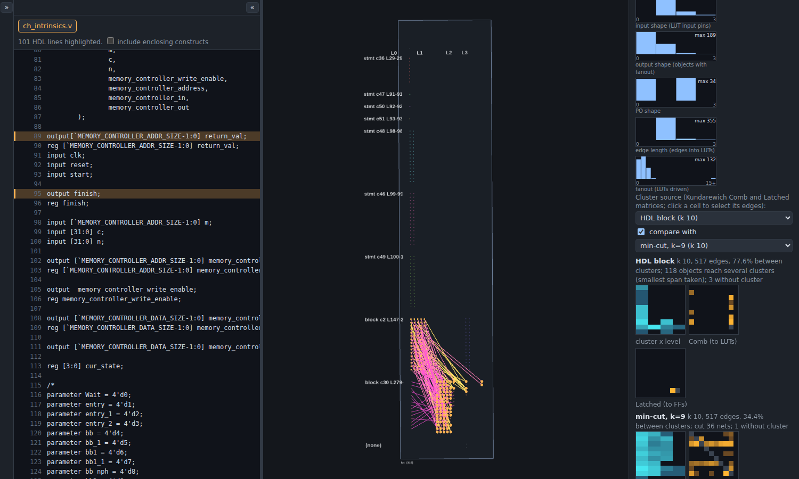

On `ch_intrinsics`: HDL block 10 clusters, 77.6% of edges between clusters; min-cut with k = 9 (+ none), 34.4%
between clusters (cut 36 nets); NMI of the two partitions 0.16. Odin III's fsm pass recodes `cur_state` to one-hot, so
after mapping the LUTs of the case merge all items: the HDL-provenance clusters are coarse there (the case is one
"block" cluster, and `hdl-item` has 217 objects reaching several items). `sha` has no FSM.

**Graded case tiers.** Below the cell plane a LUT is no longer coloured by one tier. A LUT takes the share of A (own),
B (shared) and C (context) among the cell-plane objects it was mapped from (the cell to LUT links); colour is the
mix (orange intensity = A share), a LUT with no cell link keeps its whole tier, a cluster or placed atom takes the mean
over its LUTs, hover shows the shares and the right panel counts the objects with some share of each tier.

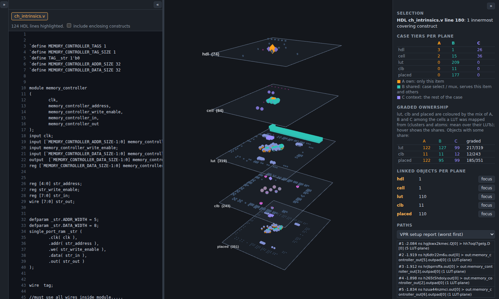 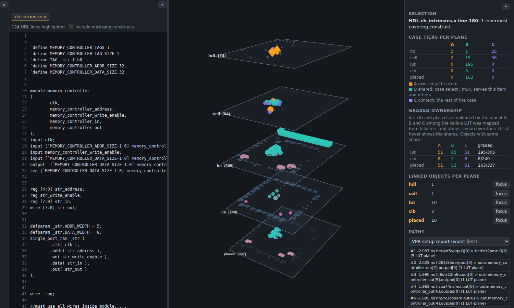

How coarse the cell to LUT links are (cells linked to a LUT, over LUTs that have any): `ch_intrinsics` with fsm,
median 65 of 84 cells (77%); the same design with the fsm pass left out, median 1 cell (1%), 75th percentile 3, max 55;
`sha`, median 1776 of 1808 cells (98%). Item 170 and item 196 of `ch_intrinsics` give the same count (90) of LUTs with an
A share with fsm (11 LUTs without it), and no LUT has A as more than half of its cells in either build. Why:
(1) the fsm pass derives one record from every cell it folds into the state machine, so every gate below
carries all of them; (2) Odin III's abc pass records the cut cone of each LUT only when the run's parent edges fit a
budget (16 x (old cells + new objects) + 65,536); `sha` needs 725,231 edges against 205,216, so abc gives all its LUTs
one shared record derived from every old cell (the log says "the run's LUTs share one record"). The budget can be set
only through the library API (`odin3_abc_run_limits`), not from a script. To keep per-LUT cell lineage on a big
design Odin III would need a pass option to raise or lift that budget, or a record that lists the gate cells of
each LUT's cut cone instead of a derived record; for fsm designs the fsm pass would need to keep one record per
state-machine cell.

**SCOAP.** The exporter adds Odin III's `scoap` pass to its second run (before the BLIF is written) and shows CC0,
CC1 and CO as metrics `cc0`, `cc1`, `co` on lut and placed (unreachable = no value). The pass numbers nets by net id;
the name map gives the same number (`$nN`) to a hash-named net, so that is the join. Each LUT is checked by recomputing
CC0 and CC1 from its cover and its inputs' values: `ch_intrinsics` 62 of 62, `sha` 1056 of 1056 checkable LUTs
agree; below 95% the values are dropped and the manifest says so. Limits: nets named after a port (primary outputs
included) have no value, because the JSON dump numbers bits by code, not by net id and the scoap JSON carries no wire
names after mapping (Odin III would need to write net ids in `write_json`, or wire names in the scoap file);
the cell plane has none, because the pass treats word-level cells as opaque (their outputs controllable, inputs
observable); use "Join: across planes" (min, max, mean) from the lut metrics to the cell and hdl planes.
Values are SCOAP as Odin III defines it, comparable with other tools only for textbook gates.

**Collapsible panels.** Each side panel has a button (left controls, HDL pane, right selection) that turns it into a
thin strip; the 3D view takes the space. Keys `[` left, `h` HDL, `]` right (the plane keys 0 to 9 are unchanged); the
state is kept in `localStorage`. The draggable HDL divider is kept.

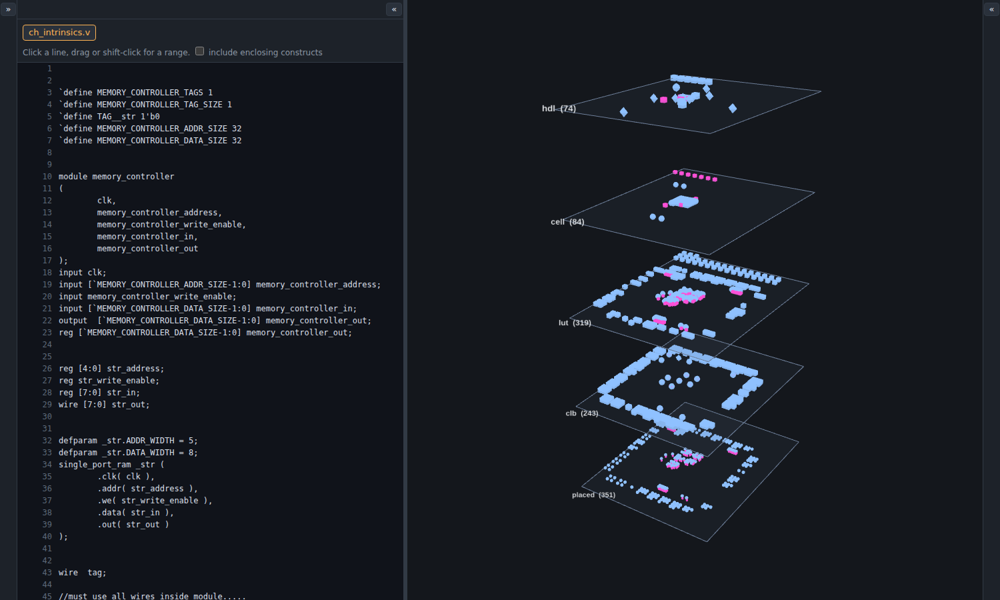

## M7: graph planes above the HDL (STG, CFG, signal DDG) and the SCOAP join

Peter 2026-11-05: show Odin III's graph exports as planes above the HDL view. Odin III writes them with
`write_graph stg|cfg|ddg FILE` (schema `odin3-graph` v1, `odin3/docs/user/graph-views.md`). `heimdall export` now runs the
three commands inside the same extra Odin III run as the M5 dumps (`cfg` just before `proc`, `stg` and `ddg` just after)
and `scoap --prov`. Use `--odin3 PATH` to run a different Odin III program than the one in the flow's log (the flow may
have used an older build). If the build lacks a command the exporter retries without it and the manifest `notes` say
which planes are missing (`no ddg plane: not in this Odin III build`). Graphs are stored in `graphs/<kind>.json` (edges
with kind, label, `seq` flag and HDL spans; node facts), the nodes are objects of the planes `stg`, `cfg`, `ddg`.

**Show them.** Left panel, "Graph planes above the HDL" (collapsible): one checkbox per plane, or the keys `s` (STG), `c`
(CFG), `d` (DDG). They are off at first, so the stack is the M6 stack; switching one on adds it above `hdl` (top to bottom:
stg, cfg, ddg, hdl, ...) and focuses it. Keys `1` to `9` still number the old planes; the "View" menu has a 2D view of each.

| Plane | Nodes | Edges | Layout |
|---|---|---|---|
| `stg` | one per FSM state (label = state code as the HDL gave it, reset state at the top) | transitions, labelled with the condition (`!reset & start`) | circle (up to 30 states, reset at the top, by distance from reset), else layered by distance from reset |
| `cfg` | per process: entry, switch, case, join, exit | `control` (switch to case, labelled with the compare patterns or `default`, pink), `seq` (grey) | top-down tree: layer = longest path from entry |
| `ddg` | signals (a bus is one node; `port` in/out/inout) and `temp` nets | `data` (blue), `control` (pink), dashed = `seq`, across a flip-flop | layered by logic order (edges across flip-flops ignored), input ports on the first layer, output ports on the last |

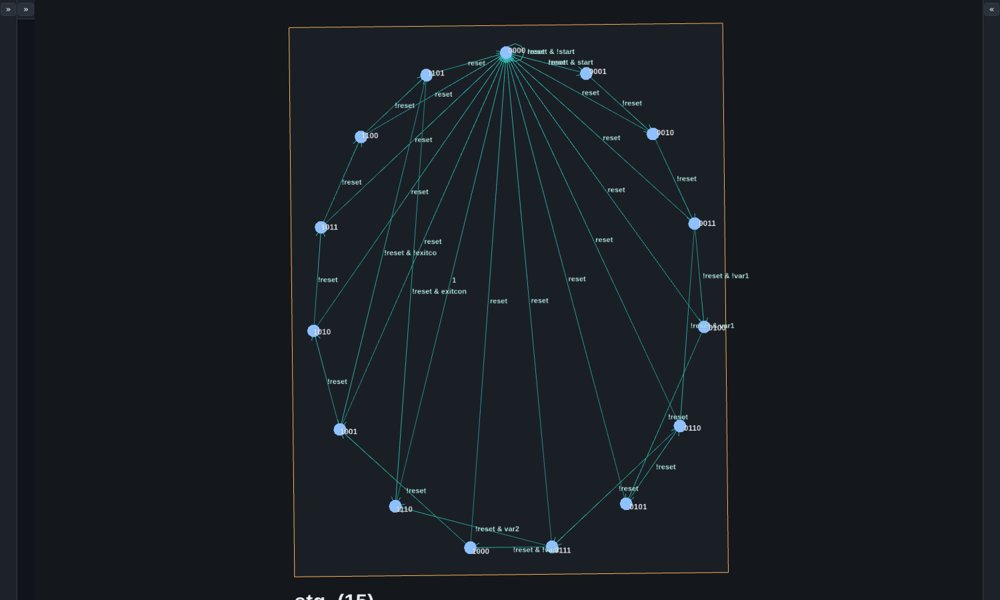

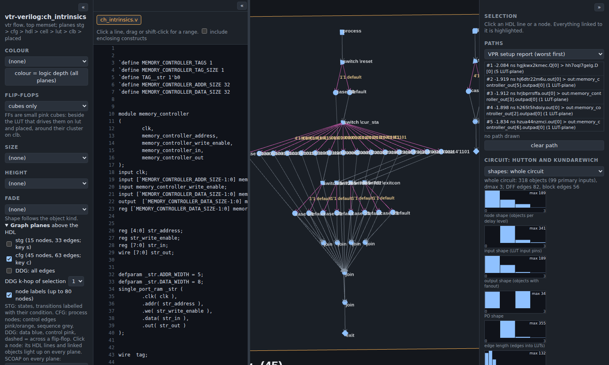

The DDG of a big design is huge (ch_intrinsics `memset` has 666 nodes and 12189 edges), so by default only the edges within
k hops of the selection are drawn (k = 1 to 4 in the panel); "DDG: all edges" draws them all. Edge labels and node labels
are drawn when there are at most 80 of them.

**Links down.** A graph node has HDL spans (`src`) and links to the objects below:

- CFG node to the HDL constructs with exactly its span; switch and entry to the cells that carry the same span; a `case` to
  the select `$eq` cells of its switch that compare with one of its patterns (`structural_match`).
- STG state to the state register (its HDL span, the declared signal, its flip-flop cells) and to the next-state selection
  logic (the spans and cells of the graph's `select_nodes`). Odin III's fsm pass does not attribute a state or a transition
  to one case item, so every state links to the same logic; this is stated by the limit, not hidden.
- DDG signal to the declared signal on the hdl plane (by name), to the cells that output that bus and to the HDL constructs
  with its span.

Through these the existing links reach the lut, clb and placed planes. Click a node: HDL lines, linked objects on every plane
and the lines behind them light up, and the right panel lists the node's edges (click an edge row: the HDL it comes from
and its two ends are selected). A CFG `case` node gets the same three case tiers as the HDL item it stands for (A own, B
shared, C context), on every plane including the graph planes; selecting an HDL line lights the graph nodes that link to
it. Clicking an STG state offers "select the state register bus" (the M5 bus selection).

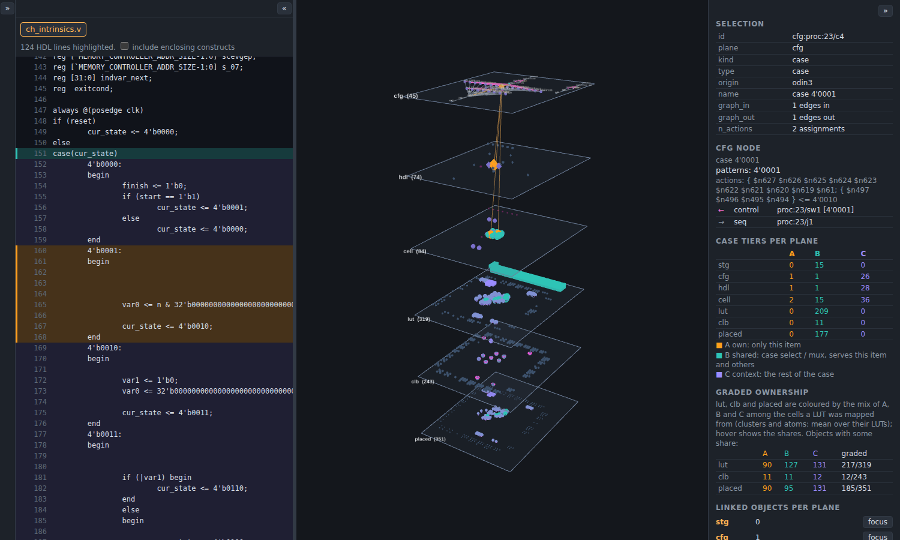

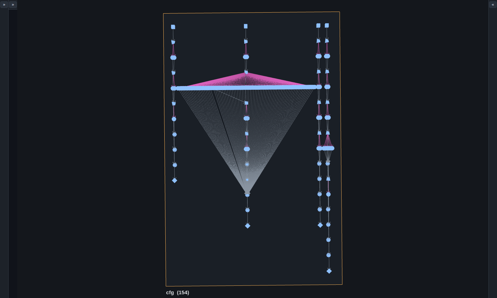

**The join key.** The graph files carry `prov`, a provenance record ID, which the Odin III spec calls the exact join key into
the name map. In this build the IDs in the graph files (for example 32 for the process of `ch_intrinsics`) are not the `rN`
numbers in the name map (`r1` for the same block with the same span), so the exporter keeps `prov` in the bundle but joins
by HDL span (and for a case item by the compared constant). Nodes with no HDL span (a CFG `join`, an STG state, the DDG
temporaries) have no span links of their own. Counts of nodes and links are in `manifest.graphs`.

**SCOAP (checked on real data, Odin III main e5efb64e).** `scoap --prov` gives each net `driver`, `wire`, `prov` and
`src`, but the pass runs on the mapped netlist, where most word-level wires are gone: on `ch_intrinsics` 107 of 319 rows
carry a wire ID, covering 7 wires, and those wire IDs belong to the DDG of the mapped netlist (so the exporter also
writes `write_graph ddg` just before `scoap`, and reads the wire's name from it). The post-`proc` DDG in the plane has
other nodes, so the join goes by name:

- a DDG signal takes the worst (largest) CC0, CC1 and CO over the rows of the mapped wire of the same name;
- a register or other named bus takes the worst over its mapped nets (the M5 bus names);
- a primary-input net of the BLIF (`m[k]`, `c[k]`, `n[k]`) takes the rows of its wire in net order (checked: the number
  of rows equals the wire width); this adds the 99 input nets M6 left grey (`ch_intrinsics`: LUT values 153 of 319
  before, 252 after; `sha`: 38 added). LUTs named after an output port or a register still have no value, because the
  rows for them carry no wire ID; this build gives no safe join for them.

Unreachable (10^18) is no value. Result: `ch_intrinsics` 13 of its 23 named DDG signals have SCOAP (the other 10, and all
643 temporaries, have none: they are not nets of the mapped netlist); `sha` 39 of 5046 nodes. Left panel: "colour =
SCOAP with joins" takes CC0, CC1 or CO and min, max or mean, and colours every plane: its own value where measured
(lut, placed, ddg), else the min, max or mean over the linked objects that have one (direct links, three rounds, so the
value reaches hdl, stg and cfg). The result is a derived metric (`cc0_max_all`); the M3 "Join: across planes" gives the
one-hop versions. Clicking a DDG signal shows its CC0, CC1 and CO.

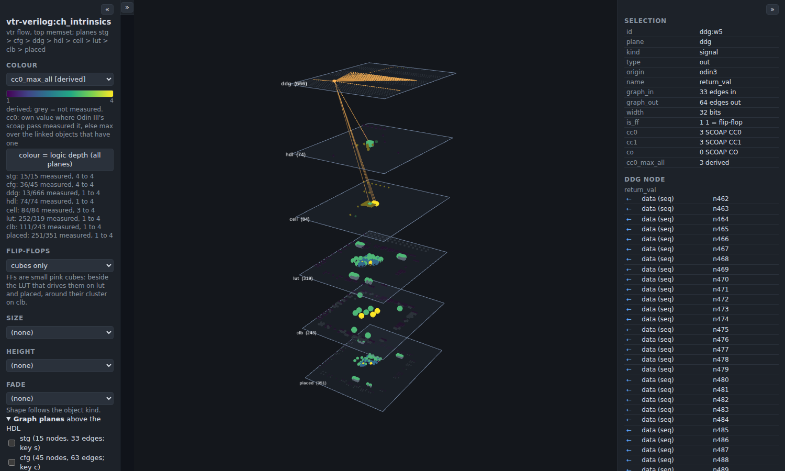

**The DDG on real data.** `ch_intrinsics` after `proc`: 666 nodes (23 named signals, 643 temporaries) and 12189 edges;
`sha`: 5046 nodes, 124406 edges. A layer wider than 40 nodes is wrapped into rows. Click a signal: its k-hop edges are
drawn from it (data blue, control pink, dashed across a flip-flop; orange at the selection); "DDG: all edges" draws all
of them (readable for `ch_intrinsics`, a dense block for `sha`; use the k-hop view there).

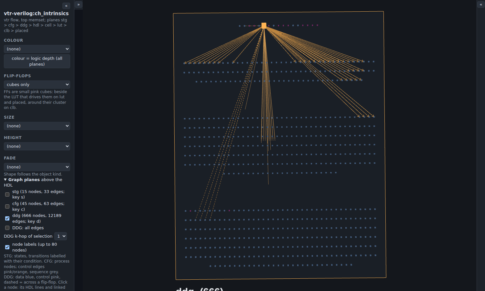

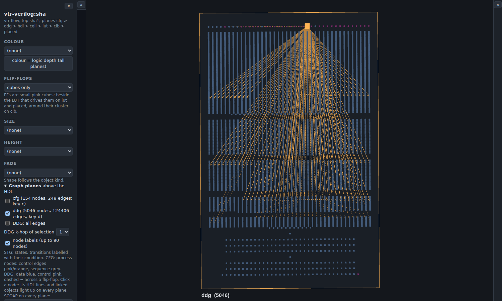

**Limits.** The STG does not attribute a transition to one case item (Odin III). Edges between graph planes (an STG
state to the CFG case that computes its transitions) are not drawn. Nodes with no HDL span (a CFG `join`, an STG state,
a DDG temporary) have no span links of their own. Output-port and register LUTs have no SCOAP value (above).

## Update 4: rainbow lines, bit squares, reverse groups

Design: `docs/specs/2026-11-06-rainbow-bits-design.md`. Controls are in the help page ("What's new (update 4)") and the
guide (example 11).

- **Rainbow lines.** Select two or more HDL lines (drag in the pane). Line k of n gets hue `270 * k / (n - 1)` degrees:
  the first line is red, the last violet; one line is red. Each line's reach (the innermost covering constructs, then
  every object below on cell, lut, clb and placed, and the graph objects above) takes its colour; an object reached
  from several lines is a pie of their colours. Flip-flops in the selection are white. The pane paints each selected
  line in its colour and puts a bar of it beside the line number. One line inside a case or if/else chain keeps the
  tier view of M5. More than 300 lines select without colours.
- **Bit squares.** The "Bits" box (URL `bits=1`) puts a flat square on the top of every highlighted object that has a
  bus bit: colour = hue ramp over the bus width, bit 0 (the LSb) red to bit width-1 (the MSb) violet. An object that
  holds the whole bus (`busk` = `own`, no bit: word cells, signal objects) gets the square striped MSb to LSb (at
  most 8 stripes). An object with an inferred bus (`busk` = `cone`) has no known bit and no square. Works for any
  selection. Body colour says line or group; the square says bit.
- **Bit order.** `bit` in the bundle is the offset from the LSb: 0 is the right index of the declaration (`[7:0]`: bit 7
  has offset 7; `[0:7]`: index 7 has offset 0; `[11:4]`: index 4 has offset 0). The manifest bus table also has `range`:
  the declared `[left, right]`. Before update 4 the lut and placed planes used the declared index for nets named
  `bus[N]` in the BLIF, which differs from the offset for any range that is not `[N:0]`; those pages were re-exported.
- **Reverse groups.** Shift-click an object (3D) starts a group in the next colour of red, orange, yellow, green, cyan,
  blue, indigo, violet (then they repeat; a group keeps its colour). Shift+Alt-click adds the object to the last group.
  A group's reach (as a plain click: everything linked above and below) takes the colour; an object in several groups
  is a pie. The HDL lines of a group (the innermost constructs in its reach, plus the own span of the clicked objects)
  are tinted in its colour; a line in several groups shows one bar per group beside its number. `Esc`, the "clear
  selection" button, or any other selection resets. URL: `grp=ID,ID;ID` (`;` between groups).

## Update 5: ASIC planes (silicon flow)

Spec: `docs/specs/2026-11-05-heimdall-design.md` section 2. `heimdall export FLOW_DIR` detects a silicon run (`prov/index.json`
flow `silicon-*`) and writes an ASIC bundle (`flow` = `silicon`); `heimdall site` takes the same specs (`,lef=FILE` for cell areas;
default: the workspace sky130 LEF). Input: the flow directory with `prov/` (steps read, map, place, recover; elab for older runs),
`or/route.def` and optionally `or/s04_global_place.csv`.

- Planes `hdl`, `stdcell`, `die`, `route` (targets common, asic, asic, asic). No `cell` plane: the silicon prov links gates to HDL
  statements (an older prov links gates to `ir` cells; the exporter composes the chain through their `fine` links).
- `die`: all DEF components except fill and decap; `x_um`, `y_um` (lower left), `row`, `flipped`, `recover_conf` (CONF rank of the
  recover step's location_match, -1 = not joined), `legal_shift_um`, `nets`, `area_um2`, `drive`. Manifest `coord.die` and
  `coord.route`: `{kind: "um", unit: "um", origin, bounds (die), core, rows {count, pitch_um, y0_um, x0_um, x1_um}, flip_y}`;
  anchor y = `flip_y` - y so the chip reads y up.
- `route`: nets of the DEF NETS section with a route and two or more instance pins; metrics `wire_um`, `vias`, `layers`,
  `hpwl_um`, `fanout`. `routes.json` holds the polylines (`[layer, x, y, x, y, ...]` in um), longest nets first, capped at 250000
  segments. The viewer draws the wires of the selected net or die cell.
- Anchors: `placement` (final legal place), `global` (cells where global placement left them), `ast`.
- Metrics carry `target` (asic or common); the manifest lists only metrics of planes present.

### Placement in the silicon flow

**Placement in the silicon flow.** The flow (`tools/silicon/openroad_flow.tcl`, OpenROAD, no Yosys,
`sky130_fd_sc_hd`) places the cells in these steps. (1) `initialize_floorplan` sizes a square core so the cells fill 25 percent of it
(utilisation 25, 6 um around the core); a design of one cell or a core below 16 um gets a fixed 30 um core, and the die grows when the pins need a longer edge or
an edge falls within 0.17 um of a routing track. (2) `tapcell` puts a well-tap cell every 14 um on every row (fixed, never moved); `pdngen`
builds the power grid. (3) `global_placement -density 0.5`, run twice around `place_pins` (first with `-skip_io`, then with the pins):
this is OpenROAD's RePlAce, an analytic placer that minimises wirelength under an electrostatic density model (Nesterov-accelerated); cells may overlap and sit off
the row grid afterwards. (4) `repair_design` resizes cells and inserts repair buffers. (5) `detailed_placement` (OpenDP) legalises the cells into
rows and sites without overlap; `clock_tree_synthesis` adds clock buffers, `repair_timing -hold` adds hold buffers, each followed by another
`detailed_placement`. (6) `global_route` (FastRoute) and `detailed_route` (TritonRoute), then fill cells.

The `die` plane shows the **final legal placement**, read from the DEF written at the end (after clock tree, repair and routing; fill cells are left
out, tap, clock and buffer cells are kept and labelled by their origin). The anchor `global` shows the same cells where global placement left them
(from the flow's `s04_global_place.csv`; cells inserted later sit at their final place), and the metric `legal_shift_um` is the
distance each cell moved to be legalised.

## Metrics

Measured by Odin III's BLIF or VPR files, never invented: `fanin`, `fanout`, `logic_level` (LUT depth from
inputs and register or block outputs; on `clb` the max over the atoms inside, on `hdl` the max over the LUTs
linked below; a cluster or construct with no measured member stays grey), `stage`, `slack_worst` and `paths_through` (VPR's worst 100 setup paths: the
worst slack of the paths through the object; objects on no reported path stay grey), `atoms`, `luts_inside`,
`ffs_inside`, `x`, `y`, `seq_level`, `is_latched`, `is_po`, `fanout_comb`, `cc0`, `cc1`, `co` (see M6 and M7), `graph_in`, `graph_out`, `is_reset`, `n_actions`, `width` (graph planes, M7), and from the step files `depth`, `children`, `span_lines`, `luts_below`, `hdl_links` and
`weakest_confidence`.

## Test

    .venv/bin/python -m unittest tests.test_o3viz tests.test_o3viz_viewer tests.test_o3viz_cells -v
    .venv/bin/python -m unittest tests.test_o3viz_help   # help page: keys vs app.js, images present
    node --test tests/js/*.test.mjs       # expression language, line and cone selection
    python tools/o3viz_shot.py BUNDLE out.png --colour slack_worst   # needs playwright + chromium

## Build a static site

    heimdall site --out SITE --base-url https://drpeterjamieson.com/RESEARCH/HEIMDALL/ \
        "vtr-verilog:ch_intrinsics=RUN_DIR,src=DIR_WITH_HDL,what=short description" ...

A spec argument may be `@FILE` with one spec per line. `SITE` holds `index.html` (a table of the benchmarks with
LUTs, FFs and a link to the Mimir catalogue), `_assets/` (the viewer, shared) and one directory per benchmark
with `index.html`, `help.html` and `bundle/` (gzip parts, no file over 40 MB). Upload the directory to any static
web host; no server code is needed. To test it locally: `python -m http.server` in `SITE`, then stop it.

## Update 6: graph analytics

Spec: `docs/specs/2026-11-05-heimdall-design.md` section 8; Odin III addition (not released) in
`docs/specs/2026-11-06-odin3-graphlet-instances.md`. Needs the Odin III binding for the export step: `heimdall site` and
`heimdall analytics` find it from `$HEIMDALL_ODIN3_ROOT` (default `~/odin3-ws/odin3`: its `.venv` Python, `plugins/python/odin3.py`,
`build/rel-main3/libodin3.so` and `glet_count`; `$ODIN3_LIB`, `--odin3-python` override). Without it no analytics are written and the
panel is hidden.

    heimdall analytics BUNDLE_OR_SITE_DIR [--only SLUG] [--silicon-flow SLUG=FLOW_DIR] [--odin3-python PY]
    heimdall refresh SITE_DIR [--note HTML]     # new viewer assets and pages on a built site, no flow run

- Graphs: lut, placed, clb (LUT edges lifted through links), ddg, cfg, stg, and stdcell and die on silicon pages (`edges/net.json`:
  driver and sink instance of each DEF net; `--silicon-flow` writes it for a page built earlier). Drivers with 16 or more sinks give no
  edges. The `cell` plane has no edges in the bundle and is skipped.
- `analytics/index.json`: per plane node and edge counts, the feature orbits, every clustering (key, k, silhouette, sizes), the
  graphlet type table (`graphlet_types`, from Odin III orbit totals and its catalogue) and the signature sets with the two Odin III
  similarity matrices. `analytics/<plane>.json`: `ids`, `gdv_u`, `gdv_d`, `cl` (labels per clustering key).
  `analytics/partition.<plane>.<feature>.<alg>.tsv` are Mimir partition imports (object id, cluster id).
- Timings are printed by `heimdall analytics` and not stored (bundles stay byte-identical on rebuild).

## v0.7: switching activity, and compare on any selection

Switching activity: see the help page ("What's new (v0.7)") and the design spec section 12.

Compare on any selection (spec section 8.1): in Graph analytics, "Compare any two selections". Pick a plane, then A and B
from the current selection (HDL lines, objects, paths), snapshots saved with the button, groups, or the clusters of the shown
clustering. The browser signs each selection (orbit totals and GDD of the members' graphlet degree vectors) and shows GDD
agreement and the cosine of log(1 + orbit totals) for the undirected and the directed graphlets, with the member counts and the
objects that have no GDV. `web/selcompare.js` is a port of Odin III's `src/graph/sig.c`; `tests/js/selcompare.test.mjs` pins it to
Odin III's values in `tests/data/selcompare/fixture.json` (made by `PYTHONPATH=. python3 tools/selcompare_fixture.py`, which runs
Odin III; since v0.8 the values come at full double precision from `odin3.graphlet_similarity`, so the match is to 1e-9).

## v0.8: graphlet instances

In Graph analytics, the graphlet type table lists the types of a plane and mode, rare first, with their counts. For every
type with at least one instance the exporter asks Odin III for the instances (`odin3.graphlet_instances`,
through `tools/odin3_glet_bridge.py`, op `instances`) and writes `analytics/instances.<plane>.<mode>.json`: per type `total`
(exact), `written`, `truncated`, `max` (`INSTANCE_MAX` = 400) and the instances as plane object indices, plus the plane's edge
list. A click on a type colours every instance: two instances conflict when they share a node or an edge joins them, DSatur
colours the conflict graph (the number of colours is shown), and a node shared by instances of several colours is a pie.
Types with 0 instances are greyed and not clickable. The file is fetched only when a type is picked, never at page load. A type with more instances than `max` says "cut at max, not all shown" (never
silent). Needs Odin III rel-main4 or later.
